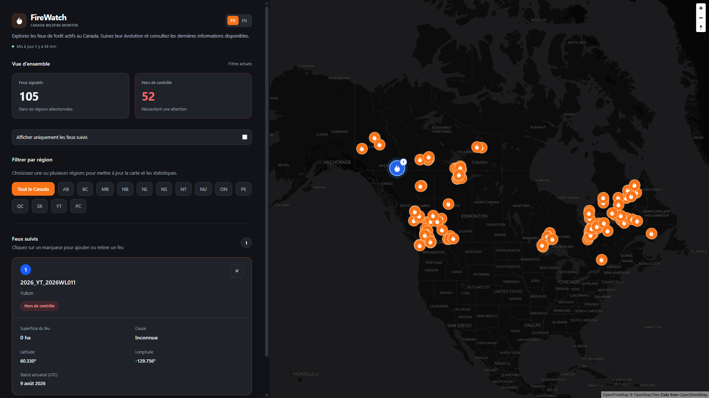

# FireWatch

[English](README.md)

**Projet portfolio, pas adapté pour une mise en production.**

FireWatch est une application web pour explorer les incendies actifs au Canada. Elle affiche leur emplacement, leur état de contrôle, leur superficie et leur pourcentage de confinement sur une carte interactive, à partir des données du Système canadien d’information sur les feux de végétation (CWFIS).



## Fonctionnalités

- Carte interactive avec les détails des incendies.
- Filtres par province.
- Sélection et suivi des incendies qui vous intéressent.
- Actualisation automatique et date de la dernière mise à jour réussie.
- Interface en français et en anglais, sur ordinateur et téléphone.

## Technologies

- **Frontend :** React, TypeScript, Tailwind CSS et MapLibre GL.
- **Backend :** Java 25 et Spring Boot.
- **Base de données :** PostgreSQL et PostGIS, gérés localement avec Docker Compose.

## Lancement local

Installer les outils suivants :

- [Git](https://git-scm.com/install/) — pour cloner le dépôt.
- [JDK 25](https://www.oracle.com/java/technologies/downloads/#java25) — pour lancer le backend. Choisir le paquet JDK adapté à votre système.
- [Node.js](https://nodejs.org/en/download/) — choisir Node.js 26.13.1. npm est inclus dans l’installateur standard.
- [Docker Desktop](https://www.docker.com/products/docker-desktop/) — inclut Docker Compose et permet de lancer la base.

Maven est fourni par le wrapper du dépôt. PostgreSQL et PostGIS sont téléchargés automatiquement par Docker : aucune installation séparée n’est nécessaire.

Démarrer Docker Desktop avant de lancer le backend. Aucun fichier `.env` n’est nécessaire.

Cloner le dépôt :

```bash
git clone https://github.com/adel-achaibou/firewatch.git
cd firewatch
```

Ouvrir ensuite deux terminaux à la racine du dépôt.

**Backend — Windows PowerShell :**

```powershell
cd backend
.\mvnw.cmd spring-boot:run
```

Sur macOS/Linux, utiliser `./mvnw spring-boot:run`. Le backend démarre la base de données avec Docker Compose.

**Frontend :**

```bash
cd frontend
npm install
npm run dev
```

Installer les dépendances une seule fois avec `npm install`. Aux lancements suivants, utiliser `npm run dev`.

Ouvrir l’adresse affichée dans le terminal, normalement **http://localhost:5173**. Le backend utilise **http://localhost:8080**. Une base neuve peut être vide avant la première mise à jour réussie.

## Source des données

Les données sur les incendies proviennent de [CWFIS](https://cwfis.cfs.nrcan.gc.ca/).
