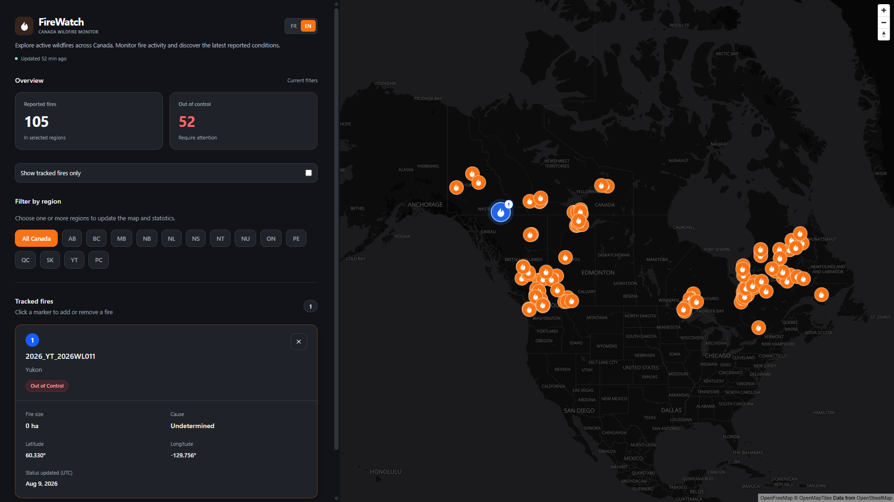

# FireWatch

[Français](README.fr.md)

FireWatch is a web application for exploring active wildfires across Canada. It displays wildfire locations, control status, size and containment information on an interactive map, using data from the Canadian Wildland Fire Information System (CWFIS).



## Features

- Interactive map with wildfire details.
- Filters by province.
- Select and track fires of interest.
- Automatic data updates and last successful update status.
- English and French interface for desktop and mobile.

## Technologies

- **Frontend:** React, TypeScript, Tailwind CSS and MapLibre GL.
- **Backend:** Java 25 and Spring Boot.
- **Database:** PostgreSQL and PostGIS, managed locally with Docker Compose.

## Run Locally

Install the following tools:

- [Git](https://git-scm.com/install/) — to clone the repository.
- [JDK 25](https://www.oracle.com/java/technologies/downloads/#java25) — to run the backend. Select the JDK package for your operating system.
- [Node.js](https://nodejs.org/en/download/) — choose Node.js 26.13.1. npm is included with the standard installer.
- [Docker Desktop](https://www.docker.com/products/docker-desktop/) — includes Docker Compose and runs the database.

Maven is provided through the repository’s wrapper. PostgreSQL and PostGIS are downloaded automatically by Docker; no separate installation is needed.

Start Docker Desktop before launching the backend. No `.env` file is required.

Clone the repository:

```bash
git clone https://github.com/adel-achaibou/firewatch.git
cd firewatch
```

Then open two terminals at the repository root.

**Backend — Windows PowerShell:**

```powershell
cd backend
.\mvnw.cmd spring-boot:run
```

On macOS/Linux, use `./mvnw spring-boot:run`. The backend starts the database through Docker Compose.

**Frontend:**

```bash
cd frontend
npm install
npm run dev
```

Install frontend dependencies once with `npm install`. For subsequent runs, use `npm run dev`.

Open the address shown in the terminal, normally **http://localhost:5173**. The backend runs on **http://localhost:8080**. A fresh database may initially be empty until the first successful data update.

## Data Source

Wildfire data is provided by [CWFIS](https://cwfis.cfs.nrcan.gc.ca/).
